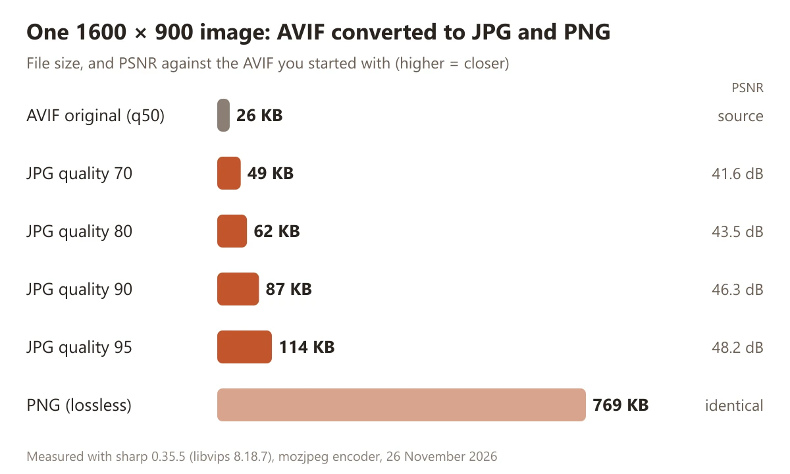

# Publishing fields

| Field | Value |
|---|---|
| Title | How to Convert AVIF to JPG Free (and Why Some Sites Won't Accept AVIF) |
| Slug | avif-to-jpg |
| Excerpt | Downloaded an image and got an .avif file that your editor, Windows PC or upload form rejects? Here's what AVIF is, why it gets turned away, and how to convert AVIF to JPG free without making it look worse. |
| Tag 1 | AVIF |
| Tag 2 | Converting |
| Tag 3 | Guides |
| Author | oMyImage Team |
| Read time | 7 min |
| Accent | #c2542c |
| SEO title | AVIF to JPG: Convert Free and Fix "File Not Supported" |
| SEO description | Got an AVIF file that won't open or upload? Learn why sites reject AVIF and how to convert AVIF to JPG free, with the quality setting we measured. |
| Scheduled publish | Thursday 2026-11-26 (today) |

## Images

| # | File | Insert | Alt text | Prompt |
|---|---|---|---|---|
| Cover | `images/avif-to-jpg-cover.webp` (1600 × 900, ChatGPT image cropped to fill the frame) | First upload, becomes the cover | An AVIF file rejected by an upload form next to the same picture as a JPG that opens everywhere | Prompt below |
| 1 | `images/avif-to-jpg-size-test.webp` (1200 × 720, **real, made with sharp**) | After the table in "What happens to quality and file size" | Bar chart: one AVIF converted to JPG at quality 70 to 95 and to PNG, with file sizes from 49 KB to 769 KB | Not AI. Drawn from the measured numbers. |

**ChatGPT cover prompt:** Clean modern editorial illustration, 16:9 landscape, 1600 × 900, full-bleed, warm cream (#F7F1E8) background. Center the subject and use the whole frame, keeping key elements away from the outer edges: a laptop showing a generic web upload form (no brand) with a red "file type not allowed" style warning icon next to a file card tagged ".avif". A dotted terracotta (#c2542c) arrow leads from that card to a second file card tagged ".jpg" with a small green check mark, sliding into the upload form's drop area. The picture on both cards is a sunny mountain landscape. Soft studio light, gentle shadows, flat minimal style, muted palette, no other readable text, no logos, no people.

Sources checked 2026-11-26 (inline links, max 4): AOMedia AVIF page (over 50% smaller than JPEG), caniuse AVIF (96.7% global support; Chrome 85, Firefox 93, Safari 16.4, Edge 121), MDN image format guide (provide a WebP, JPEG or PNG fallback), Google Search Central image guidelines (AVIF is a supported format). Also read, not linked: MDN definition (AV1 bitstream in a HEIF container), WebKit Safari 16 notes. Own test: sharp 0.35.5 / libvips 8.18.7 with mozjpeg, 2026-11-26. Keywords (OpenSEO, US): avif to jpg 33,100/mo KD 2; convert avif to jpg 5,400 KD 2; avif file 5,400 KD 30; avif to jpg converter 1,600 KD 2; what is avif 880 KD 29; how to open avif file 170 KD 0.

Internal links used (all 200 on 2026-11-26): /avif-to-jpg, /avif-to-png, /compress-image, /image-converter, /blog/heic-to-jpg-iphone-photos, /blog/jpg-vs-png-vs-webp.

---

<!-- BODY: paste everything below this line into "Body (Markdown)" -->

To convert AVIF to JPG, drop the file into a free [AVIF to JPG converter](/avif-to-jpg), keep the quality around 90, and download the JPG. It takes seconds, and the JPG opens in the editors and upload forms that turned the AVIF away. If the image has a transparent background, convert it to PNG instead so the clear areas survive.

## What an AVIF file is

AVIF stands for AV1 Image File Format. It was built by the Alliance for Open Media, the group behind the AV1 video codec, and it stores one compressed AV1 frame inside the same HEIF container that iPhones use for HEIC photos. Same box, different engine inside, and unlike HEIC it's royalty free.

Its selling point is size. The Alliance says [AVIF files can be over 50% smaller than JPEGs](https://aomedia.org/specifications/avif/) at similar quality, and that's why many image-heavy sites adopted it.

## Why you ended up with an AVIF

You probably didn't choose it. AVIFs usually arrive one of two ways.

Websites serve them. When your browser requests an image, it tells the server which formats it can display. A site that supports AVIF sends that version to modern browsers and keeps JPG for older clients. Right click, "Save image as", and you get the AVIF the browser received, even if the same picture would have downloaded as a JPG on another device.

Some apps and AI image tools also export AVIF to keep files small. Either way, the file is fine. The trouble starts when it leaves the browser.

## Why some sites and apps won't accept AVIF

Browsers took years to agree on AVIF, and they now do: [caniuse puts AVIF support at about 96.7% of users](https://caniuse.com/avif), with Chrome since version 85, Firefox since 93, Safari fully since 16.4 and Edge since 121. Everything outside the browser is slower.

Upload forms are the usual wall. Job portals, government sites, school systems, print shops and some older content management systems check the file type against a fixed list, often just "JPG, JPEG, PNG". AVIF isn't malicious or broken. It's just not on the list, so the form says "file type not allowed" or "file not supported" and stops.

Desktop software is the second wall. Older photo editors and office apps can't decode AV1. On some Windows PCs the Photos app only opens AVIF after you add Microsoft's AV1 Video Extension from the Store, and even then the file is no easier to email or upload.

Even web developers are told to plan for this. [MDN recommends serving a WebP, JPEG or PNG fallback](https://developer.mozilla.org/en-US/docs/Web/Media/Guides/Formats/Image_types) alongside AVIF, so even the web isn't treated as fully AVIF-ready.

### Can I rename .avif to .jpg?

Renaming won't work. The data inside is still AV1. Forms that check the file's contents will still reject it, others may accept it and show a broken image, and most editors will refuse to open it. You need a real conversion that decodes the image and saves it again as JPG.

## How to convert AVIF to JPG

| What you have | Best route | Batch friendly? |
|---|---|---|
| Any browser, including phones | Online AVIF to JPG converter | Yes, one ZIP |
| Mac, if Preview opens the file | File > Export > JPEG | One at a time |
| Windows PC | Browser converter (Photos may need the AV1 extension just to open it) | Yes, in the browser |
| AVIF with a transparent background | Convert to PNG instead of JPG | Yes |

### Free online, on any device

1. Open the [AVIF to JPG converter](/avif-to-jpg) and drop in one file or a whole folder.
2. Leave the quality at the default of 92, or set anything from 90 to 95.
3. Tick "Strip metadata" if you don't want camera or location data in the copy.
4. Download. One file saves directly, several arrive as a single ZIP.

The conversion runs in your browser, so the pictures stay on your device. Only a very large or very high resolution file is handed to our server for processing. If the AVIF has transparent areas, the converter fills them with a color sampled from the image's edges, or white, which beats the solid black some tools leave behind.

### On a Mac

If your Mac opens the AVIF in Preview, choose **File > Export**, pick JPEG, drag the quality slider most of the way toward Best and save. For more than a handful of files, the browser converter is quicker.

### When you need PNG instead

Pick [AVIF to PNG](/avif-to-png) when the image is a logo or cutout, or a screenshot with sharp text. PNG keeps transparency and every pixel. The cost is size: the PNG in our test was almost 30 times larger than the AVIF.

## What happens to quality and file size

We made a lossless master from a 1600 × 900 illustration, saved it as AVIF at quality 50 (26 KB), then converted that AVIF to JPG at four settings and to PNG. Closeness is PSNR against the AVIF you started with; above about 40 dB, differences are very hard to see at normal size.

| Saved as | File size | Closeness to the AVIF |
|---|---|---|
| JPG quality 70 | 49 KB | 41.6 dB |
| JPG quality 80 | 62 KB | 43.5 dB |
| JPG quality 90 | 87 KB | 46.3 dB |
| JPG quality 95 | 114 KB | 48.2 dB |
| PNG | 769 KB | identical |

Two things stand out. The JPG is always bigger than the AVIF, around three times bigger at quality 90, because JPG is a much older and less efficient format. And no setting makes the image better than the AVIF already was: the JPG can only get closer to it. A converter can't restore detail the AVIF encoder removed.

That puts the converter's default of 92 in the sweet spot. Quality 90 scored 46 dB in our test, well past the point where differences are hard to see, and the file stays modest. If a form caps the size at, say, 100 KB and your JPG is over, shrink it with the [image compressor](/compress-image) or resize it, rather than converting at quality 50.

## Will Google index my AVIF images?

Google lists AVIF among the [image formats Google Search can index](https://developers.google.com/search/docs/appearance/google-images), next to JPEG, PNG, WebP and SVG. So if you run a website, there's no SEO reason to convert your own AVIFs to JPG. Keep AVIF for the site, add a JPG or WebP fallback if you care about older software, and convert only the copies you send somewhere that refuses AVIF.

## Quick answers

### Is AVIF the same as HEIC?

Not quite. They share a container but use different codecs, so a tool that opens one may not open the other. Our [HEIC to JPG guide](/blog/heic-to-jpg-iphone-photos) covers the iPhone side.

### Is AVIF better than JPG?

For websites, usually. For anything you send or upload, JPG. Our [JPG vs PNG vs WebP guide](/blog/jpg-vs-png-vs-webp) compares the common formats.

### Can I convert AVIF to JPG in bulk?

The AVIF converter already takes a whole folder. For a batch that mixes AVIF, HEIC and WebP files, use the [image converter](/image-converter) instead.

## Your next upload

Next time a form rejects an image, look at the file extension before anything else. If it ends in .avif, convert a copy to JPG at the default quality with the [AVIF to JPG tool](/avif-to-jpg), keep the original, and upload the copy.
