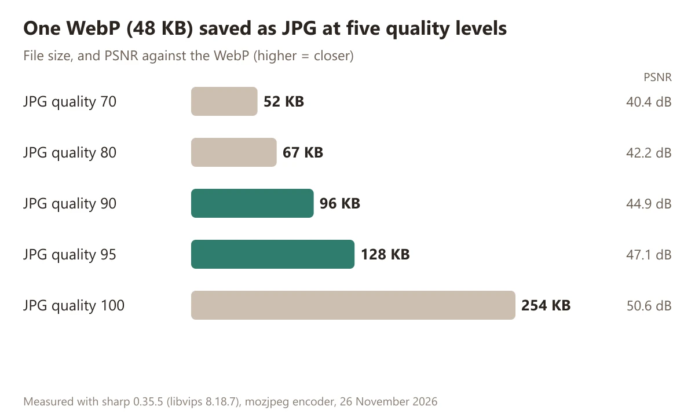

# Publishing fields

| Field | Value |
|---|---|
| Title | How to Convert WebP to JPG Without Losing Quality (Windows, Mac and Phone) |
| Slug | webp-to-jpg-without-losing-quality |
| Excerpt | Saved an image and got a .webp file your editor or upload form won't take? Here's how to convert WebP to JPG on any device, which quality setting keeps it looking right, and when PNG is the better pick. |
| Tag 1 | WebP |
| Tag 2 | Converting |
| Tag 3 | Guides |
| Author | oMyImage Team |
| Read time | 7 min |
| Accent | #2F7D6D |
| SEO title | WebP to JPG Without Losing Quality: Every Device |
| SEO description | Convert WebP to JPG on Windows, Mac or phone without visible loss. We measured which quality setting to use, and when PNG beats JPG. |
| Scheduled publish | Thursday 2026-12-10 |

## Images

| # | File | Insert | Alt text | Prompt |
|---|---|---|---|---|
| Cover | `images/webp-to-jpg-cover.webp` (1600 × 900) | First upload, becomes the cover | A WebP image file being converted into a JPG that opens in a photo editor | ChatGPT prompt below |
| 1 | `images/webp-to-jpg-quality-test.webp` (1200 × 720, **real, made with sharp**) | After the table in "Which quality setting to pick" | Bar chart: the same WebP saved as JPG at quality 70, 80, 90, 95 and 100, with file size and closeness to the WebP | Not AI. Drawn from the measured numbers. |

**ChatGPT cover prompt:** Clean modern editorial illustration, 16:9 landscape, 1600 × 900, full-bleed, warm cream (#F7F1E8) background. Center the subject and use the whole frame, keeping key elements away from the outer edges: a browser window with a bright food photo, and a small rounded file tag below it reading ".webp" with a deep teal (#2F7D6D) outline. A dotted teal arrow curves from the tag to a generic photo editing app window (no real brand) showing the same photo crisp and open, with a tag reading ".jpg" and a small green check mark. Soft studio light, gentle shadows, flat minimal style, muted palette, no other text, no logos, no people.

Sources checked 2026-11-26 (inline links, max 4): Google WebP page (25 to 34% smaller than JPEG at equal SSIM), MDN image format guide (JPEG has no alpha channel), Google WebP FAQ (q80 JPEG to q95 WebP grows the file), Apple Preview User Guide (File > Export, JPEG quality slider). Own test: sharp 0.35.5 / libvips 8.18.7 with mozjpeg, 2026-11-26, one 1600 × 900 illustration (our HEIC guide cover) saved as WebP quality 80 (48 KB). Also: one JPG q80 save re-saved nine more times at q80 (PSNR vs WebP 42.2 dB after one save, 39.8 dB after ten); a 600 × 400 transparent WebP converted with sharp's default jpeg() came out with pure black (0,0,0) in the clear areas. Keywords (OpenSEO, US): webp to jpg 90,500/mo KD 32; convert webp to jpg 18,100 KD 32; save webp as jpg 480 KD 31; how to save webp as jpg 390 KD 10.

Internal links used (must be live on publish day): /webp-to-jpg, /webp-to-png, /compress-image, /blog/jpg-vs-png-vs-webp, /blog/avif-to-jpg.

---

<!-- BODY: paste everything below this line into "Body (Markdown)" -->

To convert WebP to JPG without a visible drop in quality, convert once, from the original WebP, at a JPG quality of 90 to 95. That setting keeps the picture looking the same at normal size, and the file stays a sensible size. If the WebP has a transparent background, save it as PNG instead, because JPG will fill those clear areas with a solid color.

You probably got the WebP by right clicking an image on a website. Many large sites now serve WebP because it's small, and your download keeps the format even when your photo editor, print shop or upload form doesn't accept it.

## Why websites hand you a WebP

Google released WebP in 2010 to make web pages lighter. Its [WebP lossy images are 25 to 34% smaller than comparable JPEGs](https://developers.google.com/speed/webp) at the same measured quality, which is why online stores, news sites and Google's own pages use it.

Browsers open it without fuss. Some editors and upload forms still accept only JPG and PNG.

One more wrinkle: WebP can be lossy like JPG or lossless like PNG, and it can hold transparency. You can't tell which kind you have from the file name, and that matters for the format you convert to.

## Convert WebP to JPG on any device

| Where you are | Quickest way | Handles a batch? |
|---|---|---|
| Any browser, any device | Online WebP to JPG converter | Yes, downloads as one ZIP |
| Windows 11 | Open in Paint, then File > Save as > JPEG picture | One file at a time |
| Mac | Open in Preview, then File > Export > JPEG | One at a time |
| iPhone or Android | Browser converter | Yes |

### In the browser (works on phones too)

Drop the files into the [WebP to JPG converter](/webp-to-jpg), check the quality slider, and download. One file saves straight to your downloads, several come back as a ZIP. It starts at quality 92, inside the range we recommend below, and like our other converters it works in your browser. The [AVIF to JPG guide](/blog/avif-to-jpg) explains how it handles very large files and transparent areas.

### On Windows 11

If Paint opens your WebP, choose **File > Save as > JPEG picture**, give it a name and save. Paint shows no quality slider, so you can't control how hard it compresses. If Paint refuses the file, use the browser method.

### On a Mac

If the WebP opens in Preview, Apple's Preview guide covers the rest: [choose File > Export, pick JPEG from the Format menu and set the quality slider](https://support.apple.com/guide/preview/convert-image-file-types-prvw1012/mac).

### On an iPhone or Android phone

Phones handle WebP differently by brand and app, and neither Apple nor Google documents a built-in "save as JPG" for it. The browser converter above is the reliable route: tap the upload area, pick the image from your photos or files, and save the JPG back.

## Which quality setting to pick

We saved one 1600 × 900 image as a WebP at quality 80 (48 KB), then converted that WebP to JPG at five quality levels with sharp, the image library many websites run on. Closeness is PSNR measured against the WebP; above about 40 dB, differences are very hard to spot at normal size.

| JPG quality | File size | Closeness to the WebP |
|---|---|---|
| 70 | 52 KB | 40.4 dB |
| 80 | 67 KB | 42.2 dB |
| 90 | 96 KB | 44.9 dB |
| 95 | 128 KB | 47.1 dB |
| 100 | 254 KB | 50.6 dB |

The jump from 95 to 100 doubles the file and buys almost nothing you can see. Below 80, the score nears the 40 dB line, where JPG's own artifacts begin to show. We tested one illustration, so treat these as a guide, but quality 90 to 95 is a safe target for an image you'll print, edit or upload.

Every JPG here is bigger than the 48 KB WebP. That's normal. JPG is the older, less efficient format, and if an upload form caps the size, run the result through the [image compressor](/compress-image) rather than dropping the quality in the converter.

## Where quality really gets lost

A single conversion at a high setting is safe. The damage comes from repeats.

Each time a lossy image is saved again, the encoder throws away a little more detail. In our test, one save at quality 80 scored 42.2 dB against the WebP. After nine more saves at the same setting, the copy had slipped to 39.8 dB. Editing a downloaded JPG, saving it, sending it on and having someone else save it again does the same thing.

Raising the number doesn't restore anything. Google's WebP FAQ notes that [converting a quality 80 JPEG into a quality 95 WebP usually gives you a larger file](https://developers.google.com/speed/webp/faq), and the same holds in the other direction. The extra bytes just record the existing flaws more precisely, so start from the best copy you have, convert once and keep that file.

## When PNG is the better choice

Two kinds of WebP should go to PNG.

The first has transparency: logos, stickers, product cutouts. [JPEG has no alpha channel](https://developer.mozilla.org/en-US/docs/Web/Media/Guides/Formats/Image_types), so a JPG has to paint something into the clear areas. Some tools paint black, others white. When we converted a transparent WebP with sharp's default settings, the corners came out pure black.

The second is a lossless WebP of a screenshot, chart or text graphic. JPG smears sharp edges and adds halos around letters, while PNG keeps every pixel. Use [WebP to PNG](/webp-to-png) for both cases and accept the bigger file.

For ordinary photos, JPG is the right target. Our [JPG vs PNG vs WebP guide](/blog/jpg-vs-png-vs-webp) goes deeper on which format suits which image, and if you also have AVIF files that won't upload, the [AVIF to JPG guide](/blog/avif-to-jpg) covers that format's quirks.

## Quick answers

### Can I rename .webp to .jpg?

Renaming changes the label, but the data inside stays WebP, and many apps will refuse the file or show it as broken. A real conversion rewrites the image as JPG.

### Why can't I save a WebP image as JPG from my browser?

The website served the image as WebP to load faster, and "Save image as" keeps whatever format arrived, so the browser has no JPG to save. To save a WebP as JPG, download it and run it through a converter. Some sites send JPG to browsers that ask for it, so a different browser can give you a different file.

## Before you hit upload

Check what the form asks for. If it says JPG and your image is a photo, convert at quality 90 to 95 and you're done. If the image has a transparent background or sharp text, go to PNG. Then open the converted file once before you send it, because a black background around a logo is much easier to catch now than after the print shop calls.
