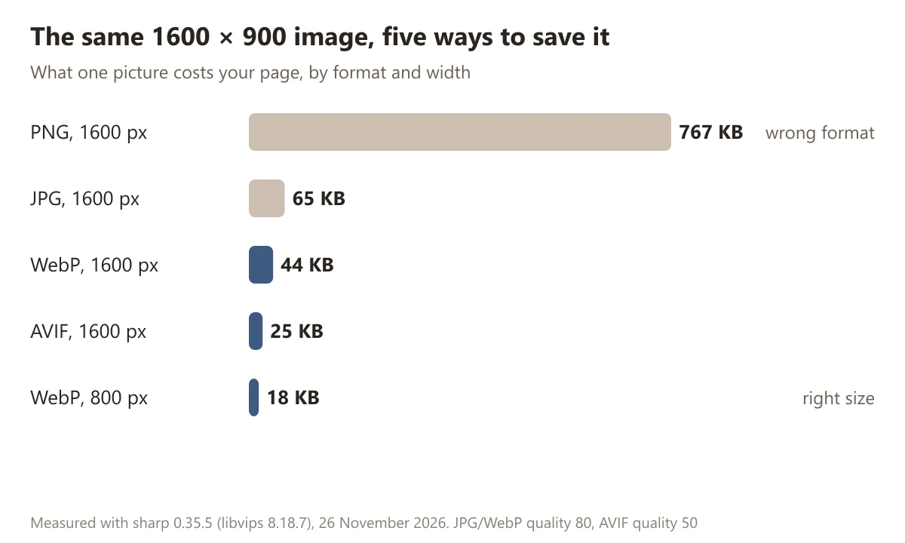

# Publishing fields

| Field | Value |
|---|---|
| Title | Why Your Images Are Slowing Down Your Website (7 Fixes That Work) |
| Slug | images-slowing-down-website |
| Excerpt | Images are the heaviest thing on most web pages. Here are the seven image mistakes that slow a site down, how to spot each one, and the fix, with sizes from our own test. |
| Tag 1 | Page speed |
| Tag 2 | Image optimization |
| Tag 3 | Guides |
| Author | oMyImage Team |
| Read time | 8 min |
| Accent | #3D5A80 |
| SEO title | Images Slowing Down Your Website? 7 Fixes That Work |
| SEO description | Images are the heaviest part of most pages. Learn how to optimize images for your website: right format, right size, and the lazy-loading mistake that hurts LCP. |
| Scheduled publish | Thursday 2026-12-17 |

## Images

| # | File | Insert | Alt text | Prompt |
|---|---|---|---|---|
| Cover | `images/images-slowing-website-cover.webp` (1600 × 900) | First upload, becomes the cover | A web page loading slowly because of one huge photo, next to the same page loading fast with optimized images | ChatGPT prompt below |
| 1 | `images/image-weight-test.webp` (1200 × 720, **real, made with sharp**) | After the table in fix 1 | Bar chart: the same 1600 by 900 image as PNG 767 KB, JPG 65 KB, WebP 44 KB, AVIF 25 KB, and WebP at 800 px 18 KB | Not AI. Drawn from the measured numbers. |

**ChatGPT cover prompt:** Clean modern editorial illustration, 16:9 landscape, 1600 × 900, full-bleed, warm cream (#F7F1E8) background. Center the subject and use the whole frame, keeping key elements away from the outer edges: two generic browser windows side by side (no real brands). The left window shows a web page with a huge blurry hero photo half loaded, a thick slate blue (#3D5A80) progress bar stuck near the start, and a small snail resting on the address bar. The right window shows the same page fully loaded and crisp, with a small lightning bolt icon. Soft studio light, gentle shadows, flat minimal style, muted palette, no readable text, no logos, no people.

Sources checked 2026-11-26 (inline links, max 4): HTTP Archive Web Almanac 2025 Page Weight (images are the most bytes on mobile and desktop; median 911 KB of images on mobile, 1,059 KB desktop), web.dev Optimize LCP ("Never lazy-load your LCP image"), web.dev Optimize CLS (always include width and height), Google Search Central page experience ("Core Web Vitals are used by our ranking systems"). Also read, not linked: Web Almanac 2024 Media chapter (68% of mobile LCP elements are images; width/height on about a third of images; 99.9% of pages request an image), web.dev LCP (2.5 s good threshold), caniuse loading="lazy" (96.9%), MDN responsive images. Own test: sharp 0.35.5 / libvips 8.18.7, 2026-11-26. Keywords (OpenSEO, US): image optimization 3,600/mo KD 55; optimize images for website 720 KD 45; image size for website 390 KD 12; lazy loading images 390 KD 24; best image format for web 260 KD 25.

Internal links (must be live on publish day): /blog/what-is-jpeg-xl-jxl, /compress-image, /resize-image, /jpg-to-webp, /png-to-webp, /reduce-image-size-in-kb, /blog/jpg-vs-png-vs-webp, /blog/webp-to-jpg-without-losing-quality.

---

<!-- BODY: paste everything below this line into "Body (Markdown)" -->

If your website feels slow, check the images first. They're usually the heaviest thing on the page, and the most common culprits are photos saved in the wrong format, photos far larger than the space they fill, and a hero image that the browser is told to load late. Each of those has a fix that takes minutes, and you don't need a developer for most of them.

Below are seven common image mistakes, how to spot each one, and how to optimize images for your website so they stop holding the page back.

## How much your images weigh, and how to find the heavy ones

The HTTP Archive measures millions of sites every year. Its 2025 Web Almanac found that [images account for more bytes than anything else on both mobile and desktop pages](https://almanac.httparchive.org/en/2025/page-weight), ahead of JavaScript and fonts. The median mobile page loaded 911 KB of images, and the median desktop page 1,059 KB.

That's the middle of the pack. A blog with a dozen full-size phone photos can easily carry ten times that.

Weight matters most for one image in particular: the biggest thing visible when the page opens. Google calls the moment it appears Largest Contentful Paint, or LCP, and wants it under 2.5 seconds. The HTTP Archive's 2024 media study found that on about two thirds of mobile pages, that largest element is an image.

To find your own slow images, run your page through PageSpeed Insights or open Chrome's DevTools, go to the Network tab, filter by Img and sort by size. Anything over a few hundred KB deserves a look.

## 1. Photos saved as PNG

PNG is lossless, which is great for logos and screenshots and terrible for photos. We saved the same 1600 × 900 image, one of our own blog illustrations, five ways to show the difference.

| Saved as | File size |
|---|---|
| PNG | 767 KB |
| JPG, quality 80 | 65 KB |
| WebP, quality 80 | 44 KB |
| AVIF, quality 50 | 25 KB |
| WebP at 800 px wide | 18 KB |

The PNG was more than 17 times the size of the WebP, for a picture that looks the same on screen, and real photos with fine detail widen the gap further because PNG compresses them even less well. If a photo on your site ends in .png, [convert it to WebP](/png-to-webp) and replace it. Keep PNG only for images that need transparency or crisp text.

## 2. Old formats where WebP would do

Even a well compressed JPG is bigger than it needs to be. In the same test, WebP came in about a third smaller than JPG at the same quality setting, and AVIF smaller again. Every current browser displays both.

For most sites, WebP is the easy switch: it's small, it supports transparency, and most CMSs and image tools can produce it. [Convert your JPGs to WebP](/jpg-to-webp) before uploading them. AVIF saves more but encodes slower and is less accepted outside browsers, and [JPEG XL](/blog/what-is-jpeg-xl-jxl) still lacks Edge support. Our [JPG vs PNG vs WebP guide](/blog/jpg-vs-png-vs-webp) walks through which format suits which picture.

## 3. Images far bigger than their slot

A modern phone camera shoots around 4000 pixels wide. A blog's content column is often 700 to 800 pixels. Upload the photo as it comes off the phone and every visitor downloads millions of pixels the browser then throws away.

In our test, simply halving the width from 1600 to 800 pixels cut the WebP from 44 KB to 18 KB. Resize before you upload: match the largest size the image will ever display at, doubled for sharp screens if you like, and stop there. The [image resizer](/resize-image) does a whole batch at once.

## 4. No compression at all

Many images go up straight from an editor's export at maximum quality. Quality 100 JPG files are often twice the size of quality 90 with no difference you can see. When we converted one WebP to JPG at different settings for our [WebP to JPG guide](/blog/webp-to-jpg-without-losing-quality), quality 100 came out at 254 KB and quality 90 at 96 KB.

For images shown on your own pages, quality 75 to 85 is a sensible range. Files you'll print or edit deserve the 90 to 95 used in that guide. Run your uploads through the [image compressor](/compress-image), or set a hard target such as 100 KB with [reduce image size in KB](/reduce-image-size-in-kb) when a platform has a size limit.

## 5. The hero image is lazy-loaded

Lazy loading is usually good advice, which is why this one slips through. Adding `loading="lazy"` tells the browser to wait until an image is about to scroll into view. For images further down the page, that saves data and speeds up the first screen.

For the big image at the top, it does the opposite. The browser holds off on the one picture the visitor is waiting for. Google's guidance is blunt: [never lazy-load your LCP image](https://web.dev/articles/optimize-lcp), because it always adds an unnecessary delay. Some WordPress themes and page builders lazy-load every image by default, hero included.

The fix is to remove `loading="lazy"` from the image at the top of the page and, ideally, add `fetchpriority="high"` to it so the browser fetches it ahead of other images. Use that only on one or two images, or it stops meaning anything.

## 6. Everything below the fold loads at once

The mirror image of mistake 5. A long article or product grid with 40 images, none of them lazy-loaded, makes the browser download all 40 up front, competing with the images the visitor can actually see.

Add `loading="lazy"` to every image that sits below the first screen. Every major browser supports it now, and most content management systems have a setting for it, though check it doesn't also catch your hero image.

## 7. No width and height on images

This one leaves load time alone and makes the page feel broken instead. When an image has no size set, the browser doesn't know how much room to keep for it, so the text jumps down when the picture finally arrives. Google measures that jump as Cumulative Layout Shift.

The HTTP Archive's 2024 study found only about a third of images have width and height set. Google's own advice is to [always include width and height attributes on images](https://web.dev/articles/optimize-cls), or reserve the space with the CSS aspect-ratio property. The numbers don't need to match the displayed size as long as your CSS sets `height: auto`; they give the browser the shape.

## Does image speed affect Google rankings?

Somewhat. Google says [Core Web Vitals are used by its ranking systems](https://developers.google.com/search/docs/appearance/page-experience), and LCP and layout shift are two of them. The same page also says there's no single page experience signal, and that Google will still show the most relevant result even when its page experience is poor.

So fixing images won't lift a weak page to the top. It removes a handicap, and it keeps visitors from leaving before your page appears, which matters whether or not Google is watching.

## Quick answers

### What size should images be for a website?

Match the widest size the image will display at, and no more. For a full-width hero that's often 1600 to 2000 pixels wide; for an image inside an article column, 800 to 1200 pixels. Aim for under 200 KB per image, and far less for small ones.

### What is the best image format for the web?

WebP for most photos and graphics, and AVIF if your tools support it. Fixes 1 and 2 above show the size difference.

### Should I use SVG for logos and icons?

Yes, when you have a vector original. An SVG stays sharp at any size and is usually tiny, so it beats PNG for logos, icons and simple illustrations. Keep photos as WebP or JPG.

## A ten-minute check

Open your slowest page, sort its images by size, and take the three biggest. Resize each to the width it really displays at, save it as WebP at quality 80, and upload it over the old one. Then check whether the top image has `loading="lazy"` on it and remove it if it does. Run PageSpeed Insights before and after; the LCP figure usually tells the story.
